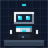
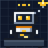
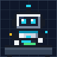
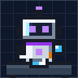
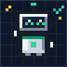
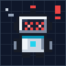

# Codex Bridge

**English** | [简体中文](README.zh-CN.md)

A **"front-of-house / back-of-house"** Antigravity plugin that wraps OpenAI Codex CLI as a controllable subagent — complete with a live **Pixel-Art Codex Monitor** right inside Antigravity's side pane.

- **Front-of-House (Antigravity / Gemini):** Handles natural conversation, clarifies vague requirements, translates intent into structured engineering briefs, and verifies and summarizes outcomes in plain human language.
- **Back-of-House (Codex CLI):** Handles heavy repository design, backend implementation, multi-file refactoring, and read-only code review — supporting both two-phase plan-then-build confirmation and on-demand invocation for everyday tasks.
- **Live Pixel Monitor (Codex Monitor):** Opens in Antigravity's right-hand side pane, isolated per conversation, showing real-time worker cards (model, reasoning effort, token breakdown, elapsed time) and an animated **Pixel Workshop** crew.

## Meet the Pixel Codex Crew

Every Codex worker gets its own color-coded `24×24` pixel bot whose pose, visor, and props react live to what it's doing:

| Idle | Thinking | Coding | Reviewing | Completed | Failed |
| :---: | :---: | :---: | :---: | :---: | :---: |
|  |  |  |  |  |  |
| Blinks on standby | Lightbulb & radar sparks | Typing fast with sparks | Sweeping magnifying glass | Cheering `^ ^` + stars | Dizzy `X X` + smoke puffs |

## Who It's For

- Developers who prefer discussing requirements naturally with Antigravity while delegating heavy coding, architecture work, or code reviews to Codex.
- Users with both Antigravity and OpenAI Codex CLI access who want seamless cross-agent orchestration and live visual progress without manually copying prompts back and forth.
- Requirements: `Python 3.9+` (zero third-party dependencies), `Node.js` (built into Antigravity for the sidecar panel), and a working local `codex` CLI (`codex login`, `OPENAI_API_KEY`, or custom `model_provider` in `$CODEX_HOME/config.toml`).

## Installation

Install directly from GitHub via Antigravity CLI:

```bash
agy plugin install https://github.com/ballShell/codex-bridge
```

Or clone into your global Antigravity plugins directory:

```bash
git clone https://github.com/ballShell/codex-bridge.git ~/.gemini/config/plugins/codex-bridge
```

> Optional environment variables: `CODEX_BIN` (custom `codex` binary path) and `CODEX_BRIDGE_ALLOW_DANGER_SANDBOX=1` (unsandboxed mode is blocked by default unless explicitly opted in).

## License

Licensed under the [MIT License](LICENSE).

---

<details>
<summary>Workspace Metadata (AgentsWorkSpace)</summary>

- **所属 Agent**：Antigravity (Gemini)
- **目录性质**：持久化（长期保留）
- **创建日期**：2026-11-21
- **任务简述**：将 OpenAI Codex CLI 封装为 Antigravity 原生插件（`codex-bridge`），实现前店后厂双模型协同。

</details>
