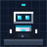
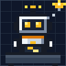
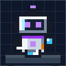
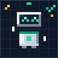
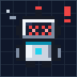

# Codex Bridge

[English](README.md) | **简体中文**

**前店后厂的双模型协作插件**：把 OpenAI Codex CLI 封装为 Antigravity 的可控 Subagent，并附带嵌入式右侧 **像素风 Codex Monitor** 实时看板。

- **前店（Antigravity / Gemini）**：发挥“会说人话”的优势，负责需求对话、追问澄清、把模糊想法翻译为结构化工程任务书，并在执行后做结果验收与人话汇报。
- **后厂（Codex CLI）**：发挥代码与工程能力强但“不爱说人话”的特点，专注复杂仓库设计、后端实现、多文件重构与代码审查——支持复杂任务“先只读出方案、确认后再落盘”，也支持日常小任务随调随用。
- **像素工坊看板（Codex Monitor）**：在 Antigravity 右侧边栏按**当前会话独立**展示所有由本对话（及子代理）派出的 Codex 状态、思考强度、Token 消耗与耗时统计，并由可爱的像素小人实时演绎工作状态。

## 像素工坊小人一览

每个派出干活的 Codex 都会化身一只 `24×24` 像素小机器人，头顶天线、护目镜表情和桌面道具会随着状态实时动起来：

| 闲置待命 | 思考规划 | 编码执行 | 代码审查 | 任务完成 | 异常中断 |
| :---: | :---: | :---: | :---: | :---: | :---: |
|  |  |  |  |  |  |
| 偶尔眨眼卖萌 | 亮起小灯泡 + 雷达 | 键盘狂敲冒火花 | 举着放大镜逐行扫 | 举手欢呼 `^ ^` + 星星 | 晕头 `X X` 冒青烟 |

## 适合谁

- 习惯在 Antigravity 里用自然语言沟通需求，希望把重型编码、架构重构或 Code Review 委派给 Codex 执行的开发者。
- 同时使用 Antigravity 与 OpenAI Codex CLI、不想手动在两个工具间来回复制上下文和 Prompt，还想顺便看着几个小机器人干活的用户。
- 运行前提：`Python 3.9+`（零三方包依赖），以及本机可用的 `codex` CLI（支持 `codex login`、`OPENAI_API_KEY` 或 `$CODEX_HOME/config.toml` 自定义 Provider）。

## 安装

方式一：通过 Antigravity CLI 直接安装

```bash
agy plugin install https://github.com/ballShell/codex-bridge
```

方式二：克隆到 Antigravity 全局插件目录

```bash
git clone https://github.com/ballShell/codex-bridge.git ~/.gemini/config/plugins/codex-bridge
```

> 可选环境变量：`CODEX_BIN`（自定义 `codex` 路径）、`CODEX_BRIDGE_ALLOW_DANGER_SANDBOX=1`（默认禁用无沙盒模式，仅在明确需要时手动开启）。

## 开源协议

基于 [MIT License](LICENSE) 开源。
